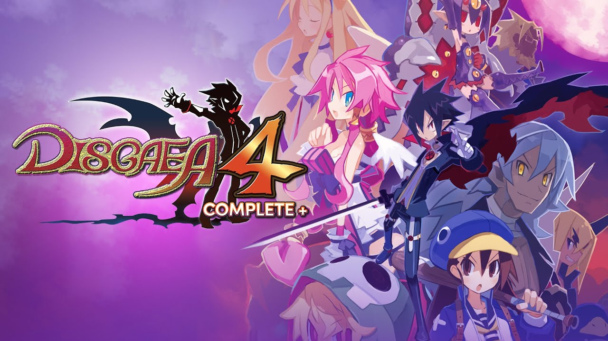
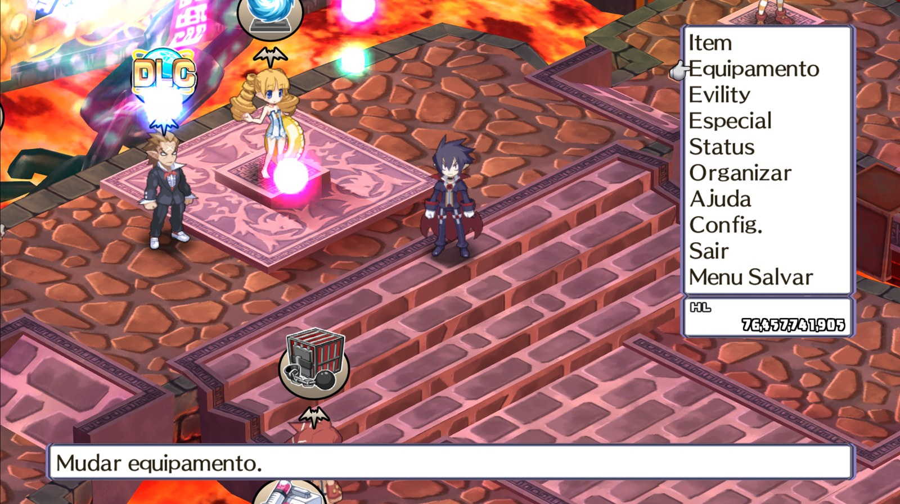
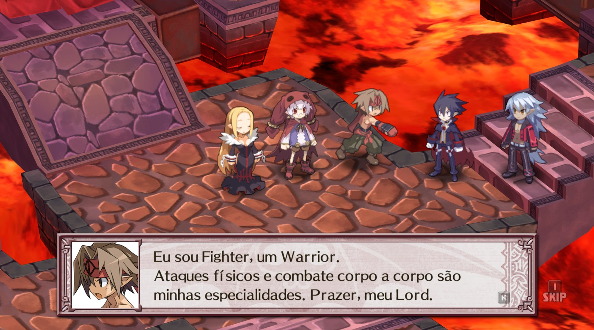

# Disgaea 4 Complete+ — Tradução PT-BR



Tradução de fã para **português do Brasil** da versão Steam de *Disgaea 4 Complete+*.
Tradução por **Maykin**.

<p>
  
  
</p>

## ⬇️ Download

Baixe o `.zip` mais recente na página de **[Releases](https://github.com/maycon-azevedo/disgaea4-ptbr/releases/latest)**.

## O que está traduzido

- Toda a história, cenas e diálogos (inclusive pós-jogo, DLCs, Fuka & Desco Show e Salto no Tempo)
- Interface, menus e tutoriais
- Descrições de itens, skills, evilities, innocents e classes
- Bestiário, projetos do Senado, Geo Effects, sala de tortura, falas dos NPCs da base e mais

Nomes próprios, nomes de itens/skills/classes e termos do jogo (Netherworld, Prinny, Item World, Evility...)
foram mantidos em inglês de propósito. Algumas falas que só existem em japonês no jogo original continuam em japonês.

> **Ainda não traduzido:** os textos dos vídeos (como a abertura "Since the dawn of time...") continuam em inglês,
> porque estão gravados na imagem do vídeo e não em arquivos de texto.

## Como instalar

1. Feche o jogo.
2. Extraia o `.zip` e execute **`Instalar_Traducao_PTBR_Disgaea4.exe`**.
3. O instalador encontra o jogo na Steam sozinho. Se não achar, clique em **Procurar...** e selecione a pasta
   `Disgaea 4 Complete+` (Steam → botão direito no jogo → Gerenciar → Ver arquivos locais).
4. Clique em **Instalar tradução**.
5. Jogue com o idioma em **inglês**. A tradução substitui o texto em inglês.

Para **desinstalar**, abra o instalador e clique em **Desinstalar (voltar ao inglês)**. Outra opção é usar
*Verificar integridade dos arquivos* na Steam.

### "O Windows protegeu o computador"

O instalador não tem assinatura digital paga, então o Windows SmartScreen pode mostrar esse aviso.
Clique em **Mais informações** → **Executar assim mesmo**.

### Steam Deck / Linux

O instalador é para Windows. No Steam Deck ou no Linux ele pode funcionar pelo Proton/Wine,
mas isso não foi testado.

## Segurança

O instalador:
- só altera `Data\DATA\EN\DATABASE_EN.dat` e `Data\DATA\EN\EN_GameString.dat`;
- antes de alterar, confere se os arquivos são exatamente os da versão suportada (SHA256);
- guarda os originais em `Data\DATA\EN\backup_original_ptbr\`.

Alguns antivírus acusam falso positivo em programas Python empacotados com PyInstaller.
O código-fonte completo do instalador está na pasta [`src/`](src/), e o hash SHA256 de cada versão
está na página da release.

## Como compilar o instalador (opcional)

> **Só quer jogar traduzido? Pule esta parte.** Basta baixar o `.zip` na página de [Releases](https://github.com/maycon-azevedo/disgaea4-ptbr/releases/latest)
> e seguir o [Como instalar](#como-instalar). Esta seção é para quem quer conferir o código ou gerar o `.exe` por conta própria.

O `.exe` da release é gerado a partir da pasta [`src/`](src/) com Python 3.13 (Windows) e PyInstaller 6.22.3:

```
cd src
pip install -r requirements.txt
python -m PyInstaller --noconfirm --onefile --windowed --name Instalar_Traducao_PTBR_Disgaea4 --add-data "traducao_ptbr.bin;." instalador.py
```

O executável sai em `src/dist/`. Também dá para rodar sem compilar: `python instalador.py`
(ou `python instalador.py --status "<pasta do jogo>"` pela linha de comando).

## Onde está o texto da tradução?

O texto traduzido fica em [`src/traducao_ptbr.bin`](src/traducao_ptbr.bin): só o texto em português, compactado
com zlib (JSON), mais os hashes SHA256 dos arquivos originais e traduzidos. Esse arquivo vai embutido no instalador,
que aplica o texto nos arquivos do seu jogo.

Os arquivos de trabalho da tradução não são publicados porque contêm o roteiro original em inglês, que pertence
à NIS America. Por isso o `build_patch.py` (que gera o `.bin`) não roda sem eles.

## Encontrou um erro?

Abra uma **[Issue](https://github.com/maycon-azevedo/disgaea4-ptbr/issues)** com:
- a frase (em inglês ou português);
- onde ela aparece (capítulo, NPC, menu);
- um print, se puder.

## Aviso legal

Projeto de fã, sem fins lucrativos e sem vínculo com a Nippon Ichi Software ou a NIS America.
É preciso ter o jogo original. Este repositório e os downloads **não contêm arquivos do jogo**, só o texto
traduzido e o programa que o aplica. *Disgaea* e as imagens relacionadas pertencem aos seus donos.
